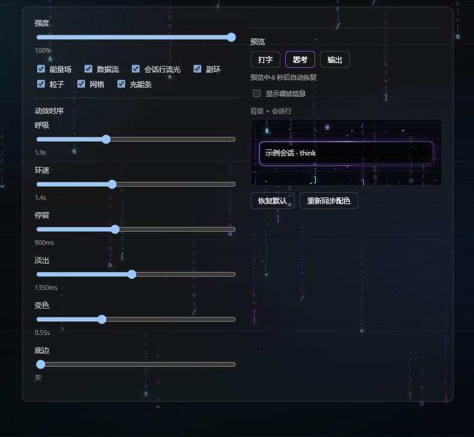
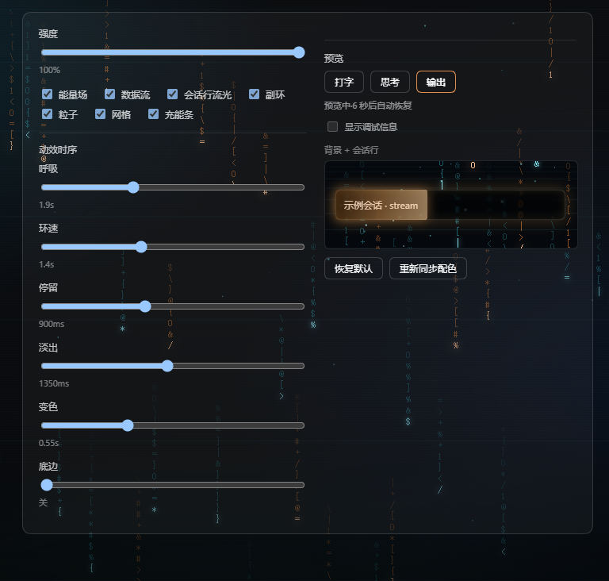

# 🛰 DSH 科幻 HUD

> 让 DeepSeek Harness 的桌面界面**跟着模型的思考与输出呼吸**。

一个客户端插件：整窗换成科幻数据流背景，侧栏每个会话行按状态亮起光环或进度条。
纯视觉，不改任何业务逻辑，不阻塞界面。

## 效果

**思考中** —— 会话行外圈双环反向旋转：



**输出中** —— 会话行内呼吸填充向右推进：



## 三种状态

| 阶段 | 判定 | 表现 |
| --- | --- | --- |
| 思考 | 回合开始后的前 3 秒 | 行外圈**双环反向旋转**（紫罗兰） |
| 输出 | 3 秒后至回合结束 | 行内**呼吸填充** + 切换瞬间行内扫光 |
| 完成 | 行状态变「已完成」/消失 | 补满 → 条内白光扫过 → 淡出 |

支持**多会话并行**：每个会话有自己的一对覆盖元素，互不干扰。

## 安装

```powershell
$prof = "$env:USERPROFILE\.dsh\profiles\desktop"

git clone https://github.com/em-chester/dsh-plugin-hud "$prof\plugins\dsh-plugin-hud"
New-Item -ItemType Junction -Path "$prof\node_modules\dsh-plugin-hud" `
  -Target "$prof\plugins\dsh-plugin-hud"
```

然后在 profile 的 `package.json` 里加：

```jsonc
{
  "dependencies": { "dsh-plugin-hud": "0.2.0" },
  "dsh": { "profile": { "bundles": ["dsh-plugin-hud"] } }
}
```

重启 DSH 生效。

## 面板

侧栏 **HUD** → 设置面板：强度、分层开关、动效时序（呼吸 / 环速 / 停留 / 淡出 / 变色 / 底边），
右侧提供**实时预览**——示例行叠在背景画布上，与正式会话行用同一套绘制逻辑。

## 测试

不需要启动应用，Node 里跑完整链路：

```bash
pnpm add -D jsdom react react-dom
node test/harness.mjs      # 18 条断言
```

覆盖：环出现 / 双环 / 5 秒切换 / 宽度区间 / 行内扫光 / 多会话并行 / 补满 / 清理 / 回车兜底。

## 实现要点

| 项 | 说明 |
| --- | --- |
| 背景 | canvas 绘制：数据流（带光头部）、上浮粒子、透视网格 |
| 行光效 | 独立 fixed 覆盖层，按 `data-row-key` 定位，**不参与宿主布局** |
| 状态来源 | ① 官方 `sessionStatus` ② 侧栏行状态标签 ③ 本地状态机，任一即可 |
| 性能 | 背景 20fps 上限；行光效纯 CSS 动画，不占主线程 |

## License

MIT
